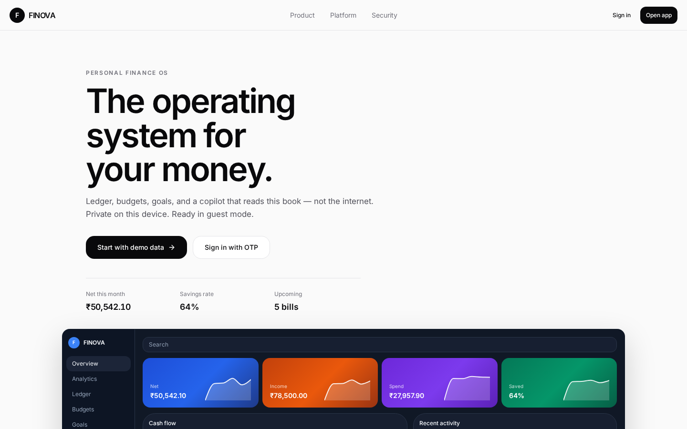
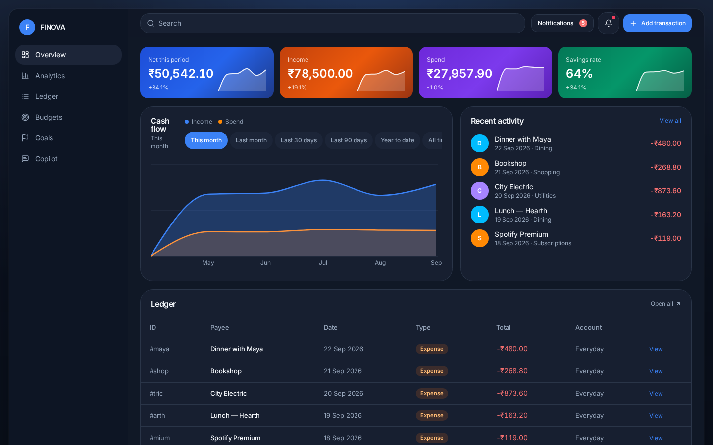

# FINOVA

Private finance OS — ledger, budgets, goals, and an on-device AI copilot.

A full-stack personal finance product: public website, OTP sign-in, live dashboard, analytics, and a copilot that only answers from the user’s own numbers.

**Not financial advice.** Demo data ships so the desk is never empty.





---

## Why this project

Built as a production-style fintech app, not a CRUD demo.

| Layer | What you can talk about in interviews |
| --- | --- |
| Product | Guest-first SaaS flow, OTP login, private ledger |
| Frontend | React 19, TanStack Router, Tailwind v4, Recharts, Motion |
| State | Zustand store + **computed** ledger (net is never stored) |
| Auth | Email / phone OTP, hashed codes, rate limits, session token |
| AI | Server-side Grok copilot with snapshot fencing + local fallback |
| Data | Typed models, sanitization, export/backup |

- Interview demo: [INTERVIEW.md](INTERVIEW.md)
- Architecture: [ARCHITECTURE.md](ARCHITECTURE.md)
- Put this on GitHub: [GITHUB.md](GITHUB.md)

---

## Features

- **Overview** — net, income, spend, savings rate, cash-flow chart, recent activity
- **Ledger** — type English (`coffee 120`, `salary 45000`) or use the form
- **Budgets & goals** — envelopes and targets that move with the book
- **Analytics** — category mix, trends, health
- **Copilot** — provides on-device insights from the ledger; optional live xAI enhancement via `XAI_API_KEY`
- **OTP auth** — email or phone, 6-digit code, guest mode without an account
- **On-device book** — data stays in the browser; export a backup anytime

---

## Stack

- **App:** React 19, TypeScript, Vite, TanStack Start / Router / Query
- **UI:** Tailwind CSS v4, shadcn/Radix, Lucide, Recharts, Motion
- **State:** Zustand
- **Auth:** custom OTP (`src/lib/auth/otp.ts`)
- **Insights:** on-device finance analysis with optional xAI enhancement (`src/lib/ai/grok.ts`)

---

## Run locally

```bash
git clone https://github.com/<your-username>/finova.git
cd finova
npm install
npm run dev
```

Open the URL Vite prints (usually `http://localhost:8080`).

| Path | Page |
| --- | --- |
| `/` | Marketing site |
| `/app` | Dashboard (guest works) |
| `/login` | Email or phone OTP |
| `/ledger` `/budgets` `/goals` `/analytics` `/advisor` | Product |

The finance copilot works without any API key. Optionally, create a local `.env` file containing `XAI_API_KEY=your_key` to enable live xAI responses. Never put the key in frontend code or commit it to Git.

```bash
npm run typecheck
```

---

## Project map

```
src/
  routes/            landing, dashboard, ledger, auth, copilot
  components/
    marketing/       public website
    finance/         charts, capture, money
    layout/          app shell
  lib/
    finance/         store, compute, parse, types
    auth/            OTP + session
    ai/              Grok copilot
```

---

## Resume line

> FINOVA — full-stack personal finance OS (React, TypeScript, TanStack). Ledger, budgets, OTP auth, and a server-side AI copilot that answers only from the user’s own transactions.

---

## License

MIT
